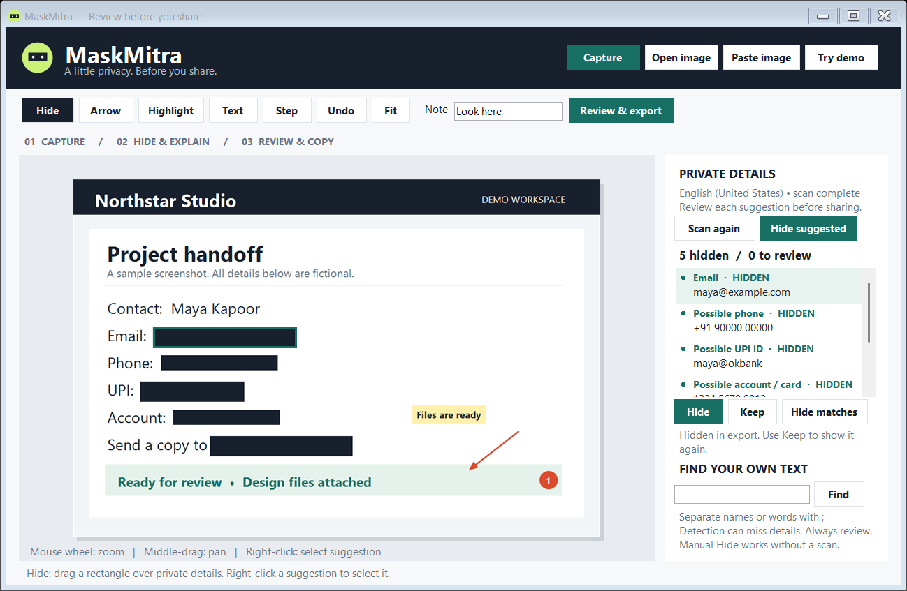

# MaskMitra

**A little privacy. Before you share.**

[](https://github.com/kartikvermagit-ds/MaskMitra/actions/workflows/build.yml)
[](https://github.com/kartikvermagit-ds/MaskMitra/releases/latest)
[](https://github.com/kartikvermagit-ds/MaskMitra/releases)
[](LICENSE)

An offline Windows screenshot editor that helps you hide private details before sharing. Capture or paste an image, review suggested emails and numbers, add an arrow or a note, then copy the clean image.

**No uploads. No account. No image history.**



## Download and start

1. **[Download MaskMitra.exe](https://github.com/kartikvermagit-ds/MaskMitra/releases/latest/download/MaskMitra.exe)** — portable app; no installer or administrator access needed.
2. Open it and choose **Try demo**, **Capture**, **Open image**, or **Paste image**.
3. Select a suggestion and choose **Hide** or **Keep**. Use **Hide matches** for repeated detected values.
4. Drag with **Hide** over anything missed, then add arrows, notes or numbered steps.
5. Choose **Review & export**, inspect the result, then **Copy clean image** or **Save PNG**.

Also available: **[Windows ZIP with guide](https://github.com/kartikvermagit-ds/MaskMitra/releases/latest/download/MaskMitra-Windows.zip)** · [SHA-256 checksums](https://github.com/kartikvermagit-ds/MaskMitra/releases/latest/download/SHA256SUMS.txt) · [Hindi quick start](docs/README.hi.md).

GitHub's green **Code → Download ZIP** downloads source code. Use the release links above for the app.

**Requirements:** Windows 10/11, .NET Framework 4.8, and an installed Windows OCR language for automatic suggestions. Manual hiding works when OCR is unavailable. English OCR is preferred when installed.

**Unsigned release:** Windows SmartScreen may show “Windows protected your PC.” This release does not yet have a verified publisher signature. Only proceed if you trust the source; Windows may offer **More info → Run anyway**. Do not disable Windows security. Managed PCs can block unsigned apps entirely.

## What it does

| Feature | Use it for |
|---|---|
| Area capture, image paste and file drop | Start from a screenshot or an existing PNG/JPEG/BMP |
| Offline text suggestions | Emails, phone-like numbers, UPI-like IDs and possible account/card/ID numbers |
| Hide / Keep / Hide matches | Decide what stays visible; cover repeated detected values together |
| Find your own text | Locate names or phrases; separate terms with `;` |
| Solid manual hiding | Cover any region the scan missed |
| Arrows, highlights, text and steps | Explain an issue or make a short visual guide |
| Undo, zoom and pan | Refine edits before exporting |
| Final preview | See exactly which image you are about to copy or save |

Press **Ctrl+Shift+M** to capture while the app is running. Other shortcuts and limits are in the [full guide](docs/GUIDE.md).

## Privacy and its limits

Image processing uses Windows' local OCR engine. The app has no upload endpoint, analytics or automatic clipboard monitoring. It does not save screenshot history. Windows clipboard history/sync can still retain images you explicitly copy.

Hidden regions are replaced with opaque pixels in the exported image. Export contains the flattened image, with no original text layer, edit history or copied source metadata. Original files are left unchanged.

**Detection can miss private information. Always inspect the entire final image.** Windows OCR missed a repeated-digit account line during testing, so manual hiding is an essential part of the workflow. Names, addresses, faces and QR codes are not automatically classified. Unreviewed suggestions remain visible in exports. See [validation and known limitations](docs/VALIDATION.md).

## Build from source

No NuGet packages or network downloads are needed to build on Windows:

```powershell
./scripts/build.ps1 -Test -Package
```

This compiles `dist/MaskMitra.exe`, runs the checks (including actual OCR), and creates the ZIP and checksums. Full tests require an installed OCR language. GitHub's Windows Server runners run the portable/core checks with `-SkipOcrTests`; actual OCR is tested separately on the local Windows build. The [recorded local results](docs/LOCAL-TEST-RESULTS.txt) list 29 passing checks for v1.0.0.

The live clipboard, global capture shortcut and mixed-DPI multi-monitor capture still need interactive validation. The automated tests use synthetic data and do not read your clipboard or capture your desktop.

## Feedback and contributions

Found a missed detection or a UI issue? [Open an issue](https://github.com/kartikvermagit-ds/MaskMitra/issues/new/choose) using fictional or already-redacted examples. Never upload real private screenshots. See [CONTRIBUTING.md](CONTRIBUTING.md).

Released under the [MIT license](LICENSE).
